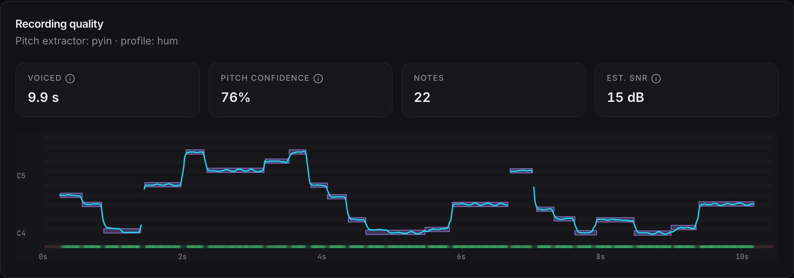
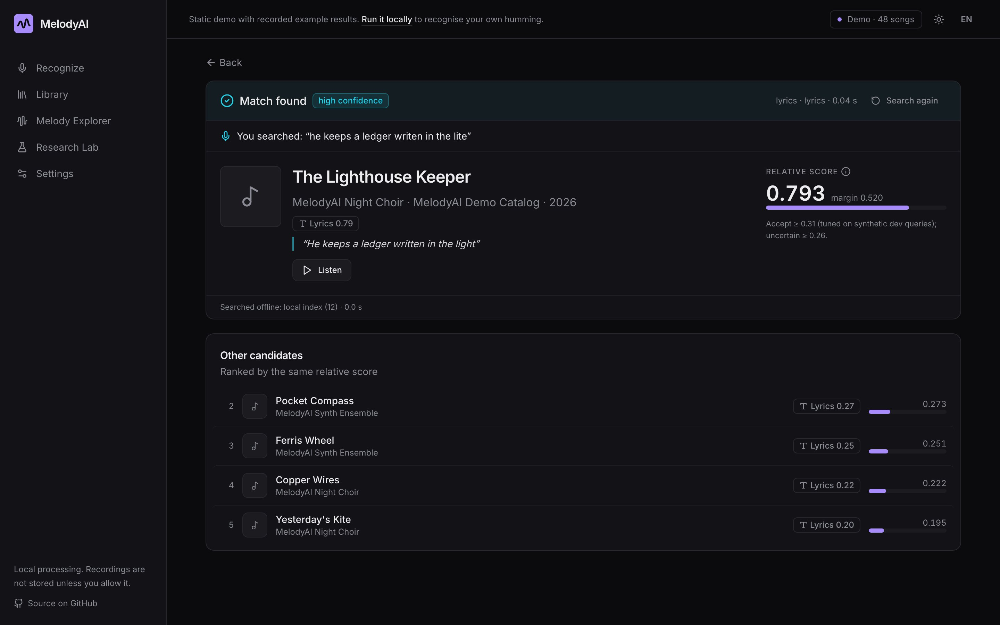
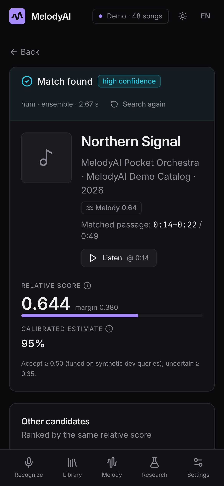
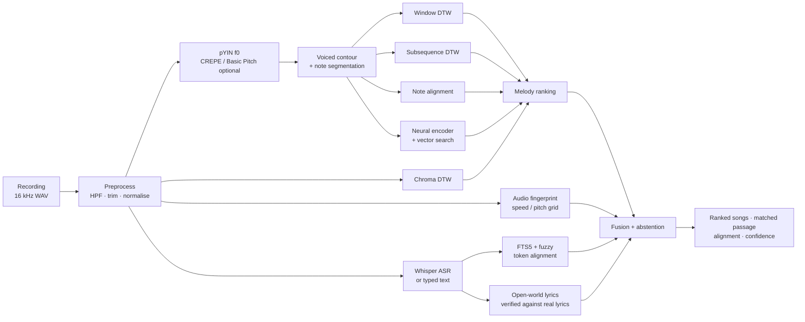

<div align="center">


# MelodyAI

**Recognise a song by humming, whistling or singing it, by a line of its lyrics, or from a clip of the track itself.**

Local-first query-by-humming engine with a web app, a reproducible benchmark and a training lab.

[](https://github.com/Ale-Newport/MelodyAI/actions/workflows/ci.yml)
[](https://ale-newport.github.io/MelodyAI/)
[](LICENSE)


[**Live demo**](https://ale-newport.github.io/MelodyAI/) · [Quick start](#quick-start) · [Commands](#commands) · [How it works](#how-it-works) · [Results](#results) · [Documentation](#documentation)

</div>


## Overview

MelodyAI explores the problem behind products like Google's *Hum to Search* with transparent engineering:
classical DSP/MIR matchers (pYIN, DTW, subsequence DTW, chroma, note alignment), a small contrastively trained neural
melody encoder, audio fingerprinting for clips, a fuzzy lyrics engine with local speech recognition, and calibrated
score fusion that says "no reliable match" instead of guessing.

- **Six input modes:** auto, hum, whistle, lyrics (typed, spoken or sung), sing + words, and *recording*: a clip of the
  actual track, sped up, slowed, transposed or recorded from a phone.
- **Any part of the song:** references are indexed as overlapping windows, so the chorus in the middle works too.
- **Explainable:** every result shows the matched passage, your melody aligned to the reference, the DTW cost matrix
  and the pitch track the engine heard.
- **Private by default:** audio is processed on your machine and is not stored unless you allow it. Optional online
  lyrics search sends only words, never audio.

> [!NOTE]
> MelodyAI ships with an *original, synthetic* 48-song catalog (CC0), so it runs out of the box with no copyrighted
> material. The benchmark numbers below are measured on synthetic queries of that catalog and are **not** real-world
> accuracy figures. Real songs are recognised mainly by their words; see [Limitations](#limitations).

## Live demo

**[ale-newport.github.io/MelodyAI](https://ale-newport.github.io/MelodyAI/)** is a static build of the web app, hosted
on GitHub Pages. It has no server: it replays example results recorded with the local engine (a hummed chorus, a
sped-up clip, a misremembered lyric line), plus the real benchmark reports and the demo catalog. To recognise your
own humming, run MelodyAI locally.

## Quick start

**Requirements:** Python 3.11 (3.10–3.12), Node.js 18+, `make`. Optional: [uv](https://github.com/astral-sh/uv) for faster
installs and `ffmpeg` for MP3/M4A uploads. No GPU, database server, Docker or API key is needed.

```bash
git clone https://github.com/Ale-Newport/MelodyAI.git
```

```bash
cd MelodyAI
```

```bash
make setup
```

```bash
make demo-data
```

```bash
make dev
```

| Step | What it does | Time |
|---|---|---|
| `make setup` | Creates `.venv` (uv or venv), installs the engine, API and all extras, and the frontend packages | a few minutes |
| `make demo-data` | Generates and imports the 48 original demo songs | ~10 s |
| `make dev` | Starts the API on http://127.0.0.1:8000 (OpenAPI at `/docs`) and the web app on http://127.0.0.1:5173 | — |

Open **http://127.0.0.1:5173**, play a song under **Practice with the catalog**, press the microphone and hum any part
of it. `Ctrl-C` stops both servers.

<details>
<summary><b>Minimal install, Docker and Windows</b></summary>

Classical engine and API only (no PyTorch, Whisper or Basic Pitch):

```bash
make setup-min
```

Docker (API and the built web app on one port, CPU only):

```bash
docker compose up --build
```

Then open http://localhost:8000. On Windows, use WSL or the equivalent commands in
[docs/INSTALLATION.md](docs/INSTALLATION.md).

</details>

### Recognise real songs

Real songs are recognised by the words you sing or type, and optionally by humming against the Lakh MIDI melodies:

```bash
make asr-model MODEL=large-v3-turbo
```

```bash
make world-sync PRESET=quick
```

```bash
make lakh
```

| Command | What it adds | Size / time |
|---|---|---|
| `make asr-model MODEL=large-v3-turbo` | Whisper model for sung or spoken lyrics | ~1.6 GB |
| `make world-sync PRESET=quick` | Local lyrics index of popular songs (`standard`: ~7,000 songs, `large`: ~24,600) | ~1,900 songs, ~30 min |
| `make lakh` | Hummable melodies of ~25,000 real songs from Lakh MIDI (CC-BY 4.0) | ~1.5 GB, ~1 h |

Online song search (LRCLIB and Deezer, free, no key) is on by default and can be switched off in **Settings**. Details
and privacy: [docs/OPEN_WORLD.md](docs/OPEN_WORLD.md) and [docs/LAKH.md](docs/LAKH.md).

## Commands

Run `make help` for the full list.

| Command | Description |
|---|---|
| `make dev` | API + web app with hot reload |
| `make backend` / `make frontend` | Run only one of them |
| `make test` | All Python tests (including slow audio end-to-end tests) and frontend tests |
| `make test-fast` | Python tests without the slow audio tests |
| `make lint` | Ruff and the TypeScript type check |
| `make evaluate-quick` | Small benchmark (~2 min) |
| `make evaluate` | Full reproducible benchmark (~25 min) → `docs/RESULTS.md` |
| `make evaluate-scale` | Scale benchmark, up to 100,000 songs (~40 min) → `docs/SCALE_RESULTS.md` |
| `make evaluate-world` | Real-song (lyrics) evaluation → `docs/WORLD_RESULTS.md` |
| `make train` | Train the neural melody encoder (~20 min on Apple Silicon) |
| `make ingest DIR=/path/to/music` | Parallel, resumable import of music you are licensed to use |
| `make build` | Production build of the web app, served by the API at http://127.0.0.1:8000 |
| `make demo-site` | Re-capture the static demo from a running API → `frontend/public/demo` |
| `make pages` | Build the static GitHub Pages demo → `frontend/dist` |

## Screenshots

| Melody Explorer | Recording quality |
|---|---|
|  |  |
| **TikTok-style clip** (sped up ×1.25, noisy) | **Misremembered lyric line** |
|  |  |
| **Research Lab** | **Library** |
|  |  |

<p align="center"></p>

## How it works



| Matcher | Representation | Invariances | Typical use |
|---|---|---|---|
| `ensemble` (default) | mean of `dtw` + `note_align` + `subseq_dtw` | key, tempo | robust default |
| `dtw` | key/time-normalised contour per window | key, tempo (scaling + banded DTW) | precise, fast |
| `subseq_dtw` | contour against the whole song | key, tempo | precise alignment and plots |
| `note_align` | note intervals + IOI ratios, Smith-Waterman | key, tempo, missing/extra notes | very fast |
| `chroma_dtw` | CQT chroma | key (12 shifts), tempo | audio-only baseline |
| `neural` / `neural_rerank` | 128-d learned embedding (+ DTW re-ranking) | learned | scalable retrieval |

Every parameter: [docs/ALGORITHMS.md](docs/ALGORITHMS.md) · design: [docs/ARCHITECTURE.md](docs/ARCHITECTURE.md) ·
literature: [docs/RESEARCH.md](docs/RESEARCH.md).

<details>
<summary><b>Project structure</b></summary>

```text
melodyai/        engine: audio, pitch, features, matching, fingerprint, lyrics, fusion, world search, training
backend/app/     FastAPI application (REST API, jobs, settings, history)
frontend/        React + TypeScript + Tailwind web app (Vite)
configs/         benchmark, training and calibration configs
scripts/         evaluation helpers and the static demo capture
tests/           unit, integration, end-to-end and benchmark tests
docs/            documentation, generated reports, figures and screenshots
experiments/     benchmark runs (metrics, per-query results, figures)
```

</details>

## Results

Measured by `make evaluate` on Apple Silicon (full report: [docs/RESULTS.md](docs/RESULTS.md)). **Dataset: synthetic**:
480 in-catalog hums, whistles and sung vowels over 10 conditions, plus 64 out-of-catalog and non-melodic queries;
thresholds tuned on a dev half, reported on the test half.

| Matcher | Top-1 | Top-5 | MRR | Latency | AUC known vs unknown |
|---|---|---|---|---|---|
| Note intervals + Smith-Waterman (`note_align`) | **97.9%** | **99.4%** | **0.985** | 6 ms | 0.980 |
| Ensemble, default (`ensemble`) | 97.7% | 98.1% | 0.979 | 511 ms | 0.960 |
| Neural embeddings (`neural`) | 95.8% | 97.7% | 0.969 | **2 ms** | **0.989** |
| Pitch contour + subsequence DTW (`subseq_dtw`) | 95.6% | 97.3% | 0.965 | 431 ms | 0.909 |
| Pitch contour + window DTW (`dtw`) | 92.9% | 96.2% | 0.946 | 74 ms | 0.863 |
| Chroma + DTW (`chroma_dtw`) | 87.7% | 94.4% | 0.907 | 366 ms | 0.861 |

- **Hardest condition:** noisy humming (10 dB SNR + reverb), 71–88% top-1 depending on the matcher; CREPE recovered every
  noisy query pYIN missed on a 72-query subset, at about twice the cost.
- **Clips** (`make evaluate-scale`, 2,000 indexed recordings): 100% top-1 for unedited and ×1.1 / ×1.25 sped-up clips,
  92–96% with +2 semitones, time-stretch, 5 dB noise or a phone mic. [docs/SCALE_RESULTS.md](docs/SCALE_RESULTS.md)
- **Humming at scale:** top-1 96.2% → 91.0% → 84.8% → 72.1% at 48 → 1,000 → 10,000 → 100,000 songs.
- **Real songs by their words** (100 songs, 24,640 indexed): the right song first for 97% of typed chorus, verse,
  single-line and misremembered queries in the local index; 92% top-1 with online search and 0 false matches.
  [docs/WORLD_RESULTS.md](docs/WORLD_RESULTS.md)

## Limitations

- **Synthetic queries only.** No real human query dataset (MTG-QBH, MIR-QBSH) has been evaluated yet;
  `scripts/evaluate_recordings.py` evaluates your own labelled, consented recordings.
- **Real songs mostly by their words.** Humming a real song is matched only against the ~25,000 Lakh MIDI songs
  (synthetic hums: 35% top-1, 55% top-5); instrumental clips of commercial songs need the optional licensed provider.
- **Spotify / TikTok audio cannot be indexed:** their terms forbid it. See [docs/SCALING.md](docs/SCALING.md).
- **Polyphonic references** (produced commercial mixes) are not solved; the experimental path was tested only on simple
  synthetic mixes.
- **Not validated here:** real microphone capture across devices, Safari/Firefox, Windows/Linux, Docker, PostgreSQL.

Full list: [docs/LIMITATIONS.md](docs/LIMITATIONS.md).

## Documentation

| Document | Contents |
|---|---|
| [INSTALLATION](docs/INSTALLATION.md) | Setup on macOS/Linux/Windows, Docker, configuration |
| [ARCHITECTURE](docs/ARCHITECTURE.md) | Components, data flow, storage, jobs, security |
| [ALGORITHMS](docs/ALGORITHMS.md) | Every algorithm with its actual parameters |
| [RESEARCH](docs/RESEARCH.md) | Problem, state of the art, references |
| [DATASETS](docs/DATASETS.md) · [TRAINING](docs/TRAINING.md) | Research datasets and licences; neural encoder training |
| [EVALUATION](docs/EVALUATION.md) · [RESULTS](docs/RESULTS.md) | Benchmark protocol; generated report |
| [SCALING](docs/SCALING.md) · [SCALE_RESULTS](docs/SCALE_RESULTS.md) | Large catalogs, licensed provider; scale benchmark |
| [OPEN_WORLD](docs/OPEN_WORLD.md) · [WORLD_RESULTS](docs/WORLD_RESULTS.md) | Real songs by their words; real-song evaluation |
| [LAKH](docs/LAKH.md) | Humming real songs with the Lakh MIDI melody index |
| [API](docs/API.md) | REST endpoints (OpenAPI at `/docs`) |
| [LIMITATIONS](docs/LIMITATIONS.md) · [CONTRIBUTING](docs/CONTRIBUTING.md) | What is verified or missing; how to contribute |

## Credits

Built on [librosa](https://github.com/librosa/librosa), [Basic Pitch](https://github.com/spotify/basic-pitch),
[torchcrepe](https://github.com/maxrmorrison/torchcrepe), [faster-whisper](https://github.com/SYSTRAN/faster-whisper),
[FAISS](https://github.com/facebookresearch/faiss), [RapidFuzz](https://github.com/rapidfuzz/RapidFuzz),
[numba](https://numba.pydata.org/), PyTorch, FastAPI, React, Radix UI, Tailwind CSS, Recharts and Lucide. Lyrics of real
songs come from [LRCLIB](https://lrclib.net) and song metadata and previews from the
[Deezer API](https://developers.deezer.com/api). Melodies of real songs come from the
[Lakh MIDI Dataset](https://colinraffel.com/projects/lmd/) by Colin Raffel (CC-BY 4.0), with titles from the Million Song
Dataset. Scientific foundations and the full bibliography: [docs/RESEARCH.md](docs/RESEARCH.md#13-references).

## License

Code: [MIT](LICENSE). Demo melodies and lyrics: original works dedicated to the public domain (CC0). Third-party models
and datasets keep their own licences and are not redistributed. Lyrics of real songs are fetched at run time into your
local store (`data/store/`, git-ignored) and are never part of the repository or the demo site.
