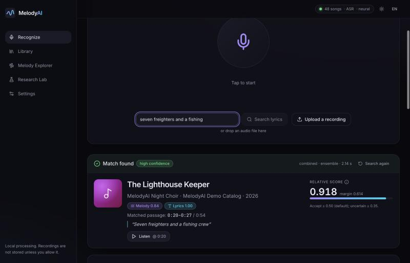
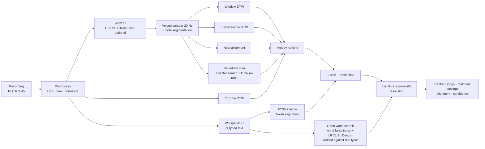
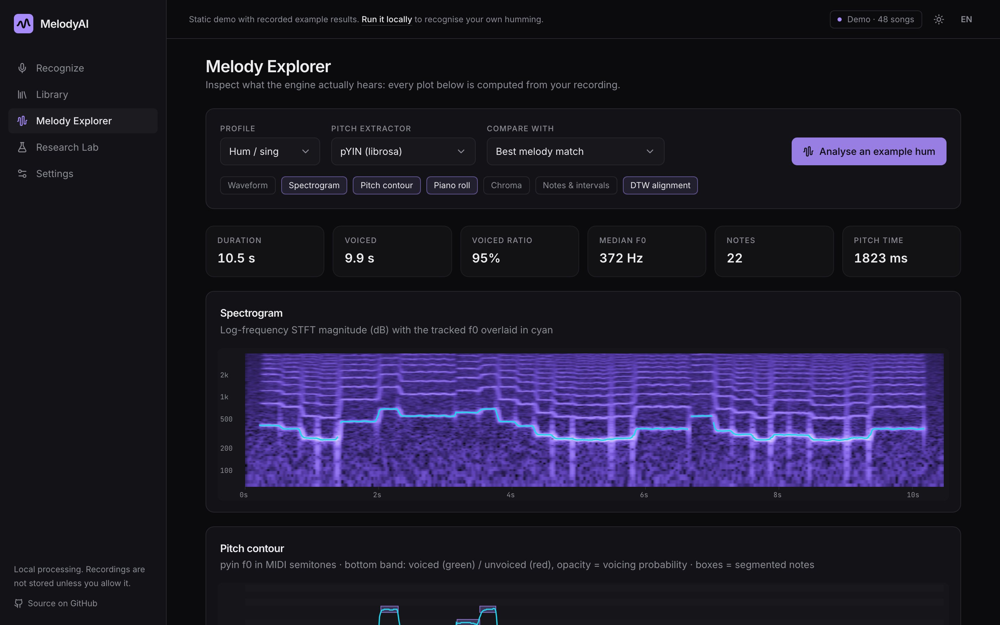
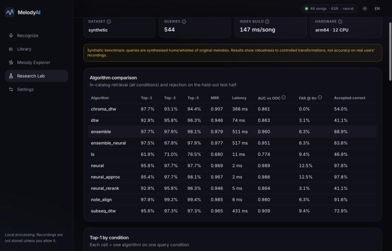
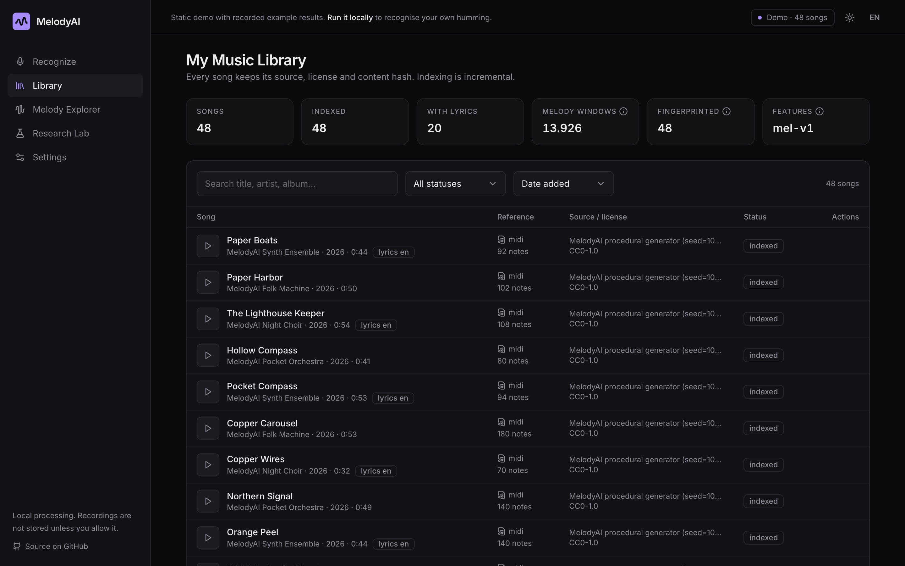
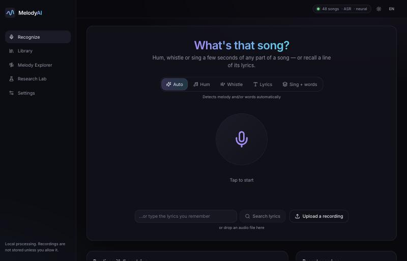
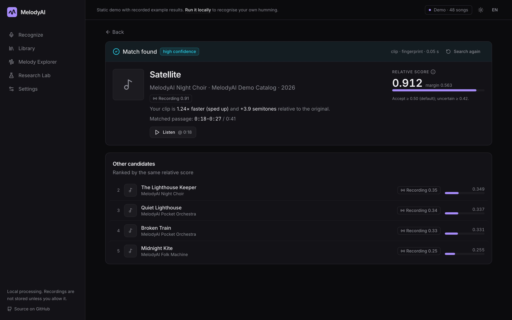

<div align="center">

# MelodyAI

**Recognise songs by humming, whistling, singing, the words you remember — or a clip of the song itself (TikTok, radio, sped up or slowed).**
A research-grade, local-first query-by-humming engine with a web app, a benchmark harness and a training lab.

[Quick start](#quick-start) · [Features](#features) · [How it works](#how-it-works) · [Results](#results) · [Limitations](#limitations) · [Docs](#documentation)

</div>



MelodyAI explores the problem behind products like Google's *Hum to Search* with transparent, reproducible engineering:
classical DSP/MIR matchers (pYIN, DTW, subsequence DTW, chroma, note alignment), a small contrastively trained neural melody
encoder, a fuzzy lyrics engine with optional local speech recognition, calibrated score fusion with abstention, and an
**open-world lyrics search** that recognises real, well-known songs by the words you sing or type.

> **Honest scope.** MelodyAI ships with an *original, synthetic* 48-song demo catalog so it works out of the box with no
> copyrighted material. The benchmark numbers in [Results](#results) are measured on synthetic queries of that catalog. They
> show that the algorithms behave as designed under controlled transformations — **they are not real-world accuracy figures**,
> and MelodyAI makes no claim of matching Google's precision, scale or catalog size. **Real songs** are recognised only by
> their *words* (Whisper transcript or typed text), through a local index of popular songs' lyrics and the free LRCLIB / Deezer
> services ([docs/OPEN_WORLD.md](docs/OPEN_WORLD.md)), with a separate real-song evaluation on 100 songs
> ([docs/WORLD_RESULTS.md](docs/WORLD_RESULTS.md)). Humming or whistling a real song without words is not recognised. See
> [Limitations](#limitations).

## Quick start

```bash
make setup        # Python 3.11 venv (uv or venv) + all extras + frontend packages
make demo-data    # generate & import the 48 original demo songs (~10 s)
make dev          # API http://127.0.0.1:8000 (docs at /docs) + web app http://127.0.0.1:5173
```

Then open the web app, listen to a song in **Practice with the catalog**, press the microphone and hum any part of it — the chorus
in the middle works too. No GPU, Docker, database server or API key is needed.

**Real songs, by their words:**

```bash
make asr-model MODEL=large-v3-turbo   # Whisper for sung lyrics (~1.6 GB; the "auto" setting picks it up)
make world-sync PRESET=quick          # lyrics of popular songs into a local index (est. ~1,900 songs, ~half an hour)
```

Then sing (or type) a line you remember. **Online song search** is on by default: the transcribed or typed words, never audio,
are also looked up on LRCLIB and Deezer, two free services with no key. You can switch it off under Settings, where the Whisper
model can also be downloaded and the popular-songs sync started. Bigger presets: `standard` (6,954 songs in 2 h 08 min,
measured) and `large` (24,640 songs, about 7 h 20 min from empty, measured). Details and privacy: [docs/OPEN_WORLD.md](docs/OPEN_WORLD.md).

Optional: `make train` (neural encoder, ~20 min on Apple Silicon), `make evaluate` (full benchmark → `docs/RESULTS.md`),
`make evaluate-scale` (scale benchmark → `docs/SCALE_RESULTS.md`), `make evaluate-world` (real-song evaluation →
`docs/WORLD_RESULTS.md`), `make ingest DIR=...` (bulk import of music you are licensed to use), `make test`.

**Spotify / TikTok songs?** Their terms forbid using their audio this way, so MelodyAI cannot index their audio itself. Songs and
clips *with words* are recognised by those words through the open-world search. For audio-only recognition of commercial songs
(instrumental clips, humming), configure the optional licensed provider (`MELODYAI_ACRCLOUD_*` exported in the server's
environment, then opt in under Settings); to build your own large catalog, ingest music you have the rights to. Details, legal
background and sizing: [docs/SCALING.md](docs/SCALING.md). Windows, Docker and configuration: [docs/INSTALLATION.md](docs/INSTALLATION.md).

## Features

| | |
|---|---|
| **Six modes** | *Auto*, *Recording* (a clip of the actual track: TikTok/Reels, radio, a song playing nearby), *Hum*, *Whistle*, *Lyrics* (spoken, sung or typed) and *Sing + words* (fused melody and lyrics evidence) |
| **Real songs by their words** | Open-world lyrics search: a Whisper transcript or typed text is matched against a local index of popular songs' lyrics (Deezer charts, TikTok viral lists, decades, Latin genres → lyrics from LRCLIB) and, if online search is on, LRCLIB / Deezer at query time; every candidate is verified against its real lyrics (fuzzy, phonetic, order-aware) before it is shown, with abstention ([how](docs/OPEN_WORLD.md)) |
| **TikTok-style clips** | Pitch-invariant audio fingerprinting with a speed grid and geometric verification: recognises sped-up/slowed, transposed, noisy and phone-recorded clips of *catalog* tracks and reports *how* they were edited (×1.25, +3.9 semitones); clips of real songs with vocals go through their words |
| **Commercial catalogs (optional)** | Opt-in adapter for a licensed provider (ACRCloud: 150 M+ tracks advertised) with Spotify/YouTube/Deezer links — MelodyAI never scrapes Spotify or TikTok ([why](docs/SCALING.md)) |
| **Built to scale** | Log-structured, memory-mapped fingerprint segments; IVF-PQ vector index (16 B/vector) with two-stage hum search; parallel resumable ingestion; measured from 48 to 100,000 songs |
| **Any part of the song** | References are indexed as overlapping multi-length windows; results report the matched time range |
| **Robustness** | Key (transposition) and tempo invariance, octave-error correction, tolerance to wrong / missing / extra notes and moderate noise — each measured per condition |
| **Abstention** | "No sufficiently reliable match was found" when evidence is weak; thresholds tuned on out-of-catalog queries; scores are *relative*, and a probability is shown only when calibrated |
| **Lyrics** | Unicode/accent normalisation, SQLite FTS5 (BM25 + trigram) and IDF-weighted fuzzy token alignment; English and Spanish; works without ASR |
| **Speech** | Local faster-whisper (`auto` = best downloaded model, `large-v3-turbo` recommended) with a VAD gate, a Spanish/English language prior, and no-speech and hallucination guards, so hums do not become invented words |
| **Neural engine** | 0.8 M-parameter conv + Transformer melody encoder, InfoNCE training on composition-disjoint synthetic data, exact/approximate vector search, DTW re-ranking |
| **Catalog** | MIDI, WAV/MP3/FLAC/OGG/M4A, TXT/JSON lyrics, CSV/JSON bulk manifests; provenance, licence and SHA-256 per song; incremental, versioned indexing |
| **Melody Explorer** | Waveform, spectrogram with f0 overlay, pitch contour with voicing confidence, piano roll, chroma, intervals, DTW cost matrix and warping path — all computed from your recording |
| **Research Lab** | Run benchmarks and training jobs in the background, compare algorithms on one recording, inspect every query, calibration curves, checkpoints |
| **Privacy** | Local processing; recordings are never stored unless you enable retention *and* consent per recording. Online song search sends only words (never audio), with hashed, short-lived cache entries and no words in logs; it can be switched off ([what leaves the machine](docs/OPEN_WORLD.md#3-sources-and-what-leaves-the-machine)) |

## How it works



| Algorithm | Representation | Invariances | Training | Typical use |
|---|---|---|---|---|
| `dtw` — window DTW | 96-pt key/time-normalised contour per window | key (median), tempo (linear scaling + banded DTW) | none | precise, fast |
| `subseq_dtw` | 10 Hz contour vs whole song | key (local candidates), tempo (5 scales + DTW) | none | precise alignment / visualisation |
| `chroma_dtw` | CQT chroma | key (12 shifts), tempo (3 scales + DTW) | none | audio-only baseline |
| `note_align` | note intervals + IOI ratios, Smith-Waterman | key & tempo by construction; missing/extra notes | none | very fast, robust to segmentation |
| `ensemble` (default) | mean of dtw + note_align + subseq_dtw scores | — | none | robust default (does not rely on one representation) |
| `neural` / `neural_approx` | 128-d embedding of the contour | learned | contrastive, synthetic | scalable retrieval |
| `neural_rerank` | neural candidates re-scored with DTW | learned + DTW | contrastive | scalable + precise |

Details: [docs/ALGORITHMS.md](docs/ALGORITHMS.md) · design: [docs/ARCHITECTURE.md](docs/ARCHITECTURE.md) ·
literature and design rationale: [docs/RESEARCH.md](docs/RESEARCH.md).

## Results

Measured by `make evaluate` (run `20261107T113552Z-default`, Apple Silicon arm64, 12 CPUs; full report with per-condition
tables, calibration, figures and environment in **[docs/RESULTS.md](docs/RESULTS.md)**). **Dataset: synthetic** — 480 in-catalog
hums/whistles/sung vowels of the 48 demo songs over 10 conditions, plus 64 out-of-catalog and non-melodic queries; thresholds tuned on
a dev half, reported on the test half.

| Algorithm | Top-1 | Top-5 | MRR | Matching latency | AUC known vs unknown | Dataset |
|---|---|---|---|---|---|---|
| Pitch contour + window DTW (`dtw`) | 92.9% | 96.2% | 0.946 | 74 ms | 0.863 | synthetic |
| Pitch contour + subsequence DTW (`subseq_dtw`) | 95.6% | 97.3% | 0.965 | 431 ms | 0.909 | synthetic |
| Chroma + DTW (`chroma_dtw`) | 87.7% | 94.4% | 0.907 | 366 ms | 0.861 | synthetic |
| Note intervals + Smith-Waterman (`note_align`) | **97.9%** | **99.4%** | **0.985** | 6 ms | 0.980 | synthetic |
| Neural embeddings (`neural`) | 95.8% | 97.7% | 0.969 | **2 ms** | **0.989** | synthetic |
| Neural + DTW re-ranking (`neural_rerank`) | 92.9% | 96.2% | 0.946 | 5 ms | 0.864 | synthetic |
| Ensemble — default (`ensemble`) | 97.7% | 98.1% | 0.979 | 511 ms | 0.960 | synthetic |
| Hybrid melody + 2 typo-ridden words (weighted fusion) | 95.0% | – | 0.955 | – | – | synthetic (40 queries; lyrics alone 90.0%, melody alone 95.0%) |

What the evidence says (and does not say):

* The hardest condition is **noisy humming** (10 dB SNR + reverb): 71–88% top-1 depending on the matcher. On a 72-query subset,
  **CREPE** recovered every noisy query that pYIN missed (100% vs 79%) at roughly twice the pitch-tracking cost.
* **Note alignment** matched or beat the ensemble at a fraction of the cost, and the small **neural encoder** (trained only on
  composition-disjoint synthetic data) is the fastest matcher with the best known-vs-unknown separation. The ensemble stays the default
  because it does not depend on note segmentation alone, which we expect to be the weak point on real recordings — a hypothesis
  that still needs real data.
* **Neural + DTW re-ranking reproduces window DTW exactly**: re-scoring with DTW imports DTW's errors. Kept as a documented negative result.
* **Fusion** never hurt and fixed ambiguous 2-word lyric queries (90% → 95%), but on this benchmark it did not beat the better single engine.
* **Polyphonic references**: Basic Pitch + skyline gave 66.7% top-1 on simple synthetic mixes (pYIN on the mix: 10.4%). Real
  produced recordings are expected to be much harder and were not tested.
* **Lyrics** (typed, misremembered, typos) and **speech** (macOS TTS → Whisper `base`) reached 100% top-1 with 0% false accepts on
  distractors; 0% of hummed/whistled queries produced words. These are easy, synthetic conditions.
* Re-running the benchmark reproduced every accuracy number exactly (fixed seeds).

### At scale and on TikTok-style clips

From `make evaluate-scale` (synthetic, full tables in **[docs/SCALE_RESULTS.md](docs/SCALE_RESULTS.md)**):

| Recording clips (8 s) among 2,000 indexed recordings | Top-1 | Accepted as match |
|---|---|---|
| unedited / sped up ×1.1 / ×1.25 | 100% | 100% |
| +2 semitones, ×1.15 time-stretch, 5 dB noise, phone mic | 92–96% | 85–94% |
| slowed ×0.8 + reverb / heavy reverb | 83% / 77% | 77% / 71% |
| someone talking over the music (as loud) | 67% | 6% |
| *unknown recordings / hummed queries accepted (false accepts)* | | *10.4% / 0%* |

Latency 383 ms mean at 2,000 recordings (38 h of audio); storage 8.2 MB per audio hour.

| Hum/whistle among N songs (two-stage) | 48 | 1,000 | 10,000 | 100,000 |
|---|---|---|---|---|
| Top-1 | 96.2% | 91.0% | 84.8% | 72.1% |
| Stage-1 recall@50 / @200 | 97.5% / 97.5% | 92.3% / 95.2% | 85.6% / 90.4% | 73.8% / 81.7% |
| Latency (stage 1 + 2) | 64 ms | 149 ms | 476 ms | 554 ms |

Humming search degrades as the catalog grows, and the limit is the neural first stage (its recall caps the top-1); exhaustive
note alignment at 10,000 songs is slightly more accurate (88.5% on a 96-query subset) but 3× slower and grows linearly.
Accuracy at Spotify scale is **not** extrapolated; [docs/SCALING.md](docs/SCALING.md) explains the architecture and what is missing.

### Real songs by their words (open world)

From `make evaluate-world` on 100 real songs (55 Spanish / 45 English, incl. 25 TikTok / viral hits and 20 older
"long-tail" songs) listed by title and artist only: queries are built from their lyrics at run time and never stored.
World index: 24,640 popular songs. Typed queries and synthetic speech (macOS voices, also "sung" with pitch steps and
vibrato); real human singing has not been evaluated. Full tables: **[docs/WORLD_RESULTS.md](docs/WORLD_RESULTS.md)**.

* Songs in the local index: the right song first for **97%** of typed chorus / verse / single-line / misremembered
  queries (TikTok group 99%), ~50 ms offline; with online search on, p50 ~0.24 s.
* All songs, index + online (the app's default): top-1 **92%**, confident match 83%, **0 false matches**.
* Online sources alone (empty index): top-1 70%, ~0.6 s p50; weaker for misremembered words and single lines.
* 0 of 58 everyday non-lyric sentences were accepted as a match, in any condition.
* Whisper `large-v3-turbo`: WER 0.04 on synthesised speech (96% top-1), ~0.5 on the synthetic "sung" version (62% top-1).

## Screenshots

| Melody Explorer | Research Lab |
|---|---|
|  |  |
| **Library** | **Recognition (home)** |
|  |  |
| **Recording mode: a sped-up clip** | |
|  | |

## Limitations

* **Synthetic queries only.** No real human query dataset has been evaluated yet (MTG-QBH, MIR-QBSH… must be obtained under their
  licences). The open-world evaluation uses real songs, but its queries are typed text and synthesised speech built from their
  lyrics. `scripts/evaluate_recordings.py` evaluates your own labelled, consented recordings.
* **Catalog size.** Measured up to 100,000 synthetic songs (hum) and 2,000 synthetic recordings (clips); hum accuracy degrades
  with catalog size (see Results). Nothing was measured on real commercial catalogs.
* **Real songs only by their words.** The open-world search needs lyrics: humming or whistling a real song, and instrumental
  clips, are not recognised. That would need melodic references (Lakh MIDI was deliberately not downloaded) or the licensed
  provider. Coverage is the local index plus what LRCLIB / Deezer know. The first lookup of a song that is not indexed needs
  the internet. A cover may be shown instead of the original. The `world` thresholds stay provisional until they are
  calibrated on the full index ([details](docs/OPEN_WORLD.md#11-limitations)).
* **Polyphonic recordings.** Matching against produced commercial mixes is *not* solved here: the experimental Basic Pitch + skyline
  path was only measured on simple synthetic mixes.
* **macOS vector search.** FAISS cannot share a process with PyTorch on macOS wheels (duplicate `libomp`); NumPy exact/IVF search is
  used there (FAISS elsewhere).
* **Not validated here:** real microphone capture, Safari/Firefox, Windows/Linux, Docker, PostgreSQL.

Full list: [docs/LIMITATIONS.md](docs/LIMITATIONS.md).

## Roadmap

1. Adapters and evaluation for MTG-QBH / MIR-QBSH (real hummed queries), then fine-tuning the encoder on real queries
   (stage-1 recall is the bottleneck of large-catalog hum search).
2. Sharded fingerprint/ANN services and a live round trip with the licensed provider once credentials are available.
3. Source separation (e.g. Demucs) + f0 tracking for polyphonic references, evaluated on licensed multitrack data (MedleyDB).
4. Spectrogram-domain dual encoder (closer to Hum to Search) once real paired data is available.
5. ONNX inference (to allow FAISS on macOS) and wiring the two-stage search into the live catalog as its default.
6. Lyrics-to-melody alignment so sung words and melody constrain the same time span.
7. Open world: the full real-song evaluation on the complete popular-songs index, calibration of the `world` thresholds, and
   real sung recordings / TikTok clips as test queries.

## Documentation

| | |
|---|---|
| [INSTALLATION](docs/INSTALLATION.md) | setup on macOS/Linux/Windows, Docker, configuration, what was validated |
| [ARCHITECTURE](docs/ARCHITECTURE.md) | components, data flow, storage, jobs, security |
| [ALGORITHMS](docs/ALGORITHMS.md) | every algorithm with its actual parameters |
| [RESEARCH](docs/RESEARCH.md) | problem, state of the art, references, differences with the original research |
| [DATASETS](docs/DATASETS.md) | research datasets, licences, access and how they could be used |
| [TRAINING](docs/TRAINING.md) | neural encoder data, leakage control, objective, outputs |
| [EVALUATION](docs/EVALUATION.md) | benchmark protocol and conditions |
| [RESULTS](docs/RESULTS.md) | auto-generated benchmark report |
| [SCALING](docs/SCALING.md) | Spotify/TikTok constraints, licensed provider setup, large-catalog architecture |
| [SCALE_RESULTS](docs/SCALE_RESULTS.md) | auto-generated scale benchmark (48 → 100,000 songs; TikTok-style edits) |
| [OPEN_WORLD](docs/OPEN_WORLD.md) | real songs by their words: pipeline, sources, what leaves the machine, popular-songs sync, settings, limits |
| [WORLD_RESULTS](docs/WORLD_RESULTS.md) | auto-generated real-song (open-world) evaluation |
| [API](docs/API.md) | REST endpoints (OpenAPI at `/docs`) |
| [LIMITATIONS](docs/LIMITATIONS.md) | what is verified, experimental, missing |
| [CONTRIBUTING](docs/CONTRIBUTING.md) | workflow, adding matchers/extractors, data rules |

## Credits

Built on [librosa](https://github.com/librosa/librosa) (pYIN, CQT), [Basic Pitch](https://github.com/spotify/basic-pitch),
[torchcrepe](https://github.com/maxrmorrison/torchcrepe), [faster-whisper](https://github.com/SYSTRAN/faster-whisper),
[FAISS](https://github.com/facebookresearch/faiss), [RapidFuzz](https://github.com/rapidfuzz/RapidFuzz), [numba](https://numba.pydata.org/),
PyTorch, FastAPI, React, Radix UI, Tailwind CSS, Recharts and Lucide. Lyrics of real songs come from [LRCLIB](https://lrclib.net)
and song metadata, charts and previews from the [Deezer API](https://developers.deezer.com/api). Scientific foundations: Mauch & Dixon (pYIN), Kim et al. (CREPE),
Müller (DTW / subsequence DTW), Sakoe & Chiba, Ghias et al. and McNab et al. (query by humming), Jang (MIR-QBSH, linear scaling),
Cormack et al. (RRF), van den Oord et al. (InfoNCE), Guo et al. (calibration), and Google Research's *The Machine Learning Behind
Hum to Search*. Full bibliography in [docs/RESEARCH.md](docs/RESEARCH.md#13-references).

## License

Code: MIT. Demo melodies and lyrics: original works dedicated to the public domain (CC0). Third-party models and datasets keep
their own licences and are not redistributed. Lyrics of real songs are fetched at run time into your local store
(`data/store/`, git-ignored) and are never part of the repository. See [LICENSE](LICENSE).
