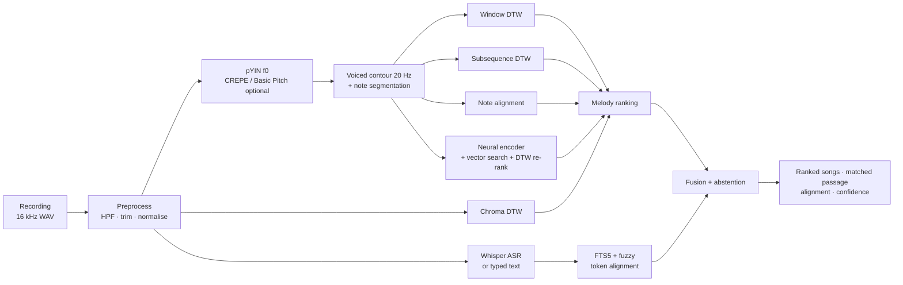

<div align="center">

# MelodyAI

**Recognise songs by humming, whistling, singing — or the words you remember.**
A research-grade, fully local query-by-humming engine with a web app, a benchmark harness and a training lab.

[Quick start](#quick-start) · [Features](#features) · [How it works](#how-it-works) · [Results](#results) · [Limitations](#limitations) · [Docs](#documentation)

</div>


MelodyAI explores the problem behind products like Google's *Hum to Search* with transparent, reproducible engineering:
classical DSP/MIR matchers (pYIN, DTW, subsequence DTW, chroma, note alignment), a small contrastively trained neural melody
encoder, a fuzzy lyrics engine with optional local speech recognition, and calibrated score fusion with abstention.

> **Honest scope.** MelodyAI ships with an *original, synthetic* 48-song demo catalog so it works out of the box with no
> copyrighted material. All benchmark numbers are measured on synthetic queries of that catalog. They show that the
> algorithms behave as designed under controlled transformations — **they are not real-world accuracy figures**, and MelodyAI
> makes no claim of matching Google's precision, scale or catalog size. See [Limitations](#limitations).

## Quick start

```bash
make setup        # Python 3.11 venv (uv or venv) + all extras + frontend packages
make demo-data    # generate & import the 48 original demo songs (~10 s)
make dev          # API http://127.0.0.1:8000 (docs at /docs) + web app http://127.0.0.1:5173
```

Then open the web app, listen to a song in **Practice with the catalog**, press the microphone and hum any part of it — the chorus
in the middle works too. No GPU, Docker, database server, API key or cloud service is needed.

Optional: `make asr-model MODEL=base` (Whisper for spoken/sung lyrics), `make train` (neural encoder, ~20 min on Apple Silicon),
`make evaluate` (full benchmark → `docs/RESULTS.md`), `make test`. Windows, Docker and configuration: [docs/INSTALLATION.md](docs/INSTALLATION.md).

## Features

| | |
|---|---|
| **Five modes** | *Auto*, *Hum*, *Whistle*, *Lyrics* (spoken, sung or typed) and *Sing + words* (fused melody and lyrics evidence) |
| **Any part of the song** | References are indexed as overlapping multi-length windows; results report the matched time range |
| **Robustness** | Key (transposition) and tempo invariance, octave-error correction, tolerance to wrong / missing / extra notes and moderate noise — each measured per condition |
| **Abstention** | "No sufficiently reliable match was found" when evidence is weak; thresholds tuned on out-of-catalog queries; scores are *relative*, and a probability is shown only when calibrated |
| **Lyrics** | Unicode/accent normalisation, SQLite FTS5 (BM25 + trigram) and IDF-weighted fuzzy token alignment; English and Spanish; works without ASR |
| **Speech** | Local faster-whisper with VAD, no-speech and hallucination guards, so hums do not become invented words |
| **Neural engine** | 0.8 M-parameter conv + Transformer melody encoder, InfoNCE training on composition-disjoint synthetic data, exact/approximate vector search, DTW re-ranking |
| **Catalog** | MIDI, WAV/MP3/FLAC/OGG/M4A, TXT/JSON lyrics, CSV/JSON bulk manifests; provenance, licence and SHA-256 per song; incremental, versioned indexing |
| **Melody Explorer** | Waveform, spectrogram with f0 overlay, pitch contour with voicing confidence, piano roll, chroma, intervals, DTW cost matrix and warping path — all computed from your recording |
| **Research Lab** | Run benchmarks and training jobs in the background, compare algorithms on one recording, inspect every query, calibration curves, checkpoints |
| **Privacy** | Local processing; recordings are never stored unless you enable retention *and* consent per recording |

## How it works



| Algorithm | Representation | Invariances | Training | Typical use |
|---|---|---|---|---|
| `dtw` — window DTW | 96-pt key/time-normalised contour per window | key (median), tempo (linear scaling + banded DTW) | none | precise, fast |
| `subseq_dtw` | 10 Hz contour vs whole song | key (local candidates), tempo (5 scales + DTW) | none | precise alignment / visualisation |
| `chroma_dtw` | CQT chroma | key (12 shifts), tempo (3 scales + DTW) | none | audio-only baseline |
| `note_align` | note intervals + IOI ratios, Smith-Waterman | key & tempo by construction; missing/extra notes | none | very fast, robust to segmentation |
| `ensemble` (default) | mean of dtw + note_align + subseq_dtw scores | — | none | robust default (does not rely on one representation) |
| `neural` / `neural_approx` | 128-d embedding of the contour | learned | contrastive, synthetic | scalable retrieval |
| `neural_rerank` | neural candidates re-scored with DTW | learned + DTW | contrastive | scalable + precise |

Details: [docs/ALGORITHMS.md](docs/ALGORITHMS.md) · design: [docs/ARCHITECTURE.md](docs/ARCHITECTURE.md) ·
literature and design rationale: [docs/RESEARCH.md](docs/RESEARCH.md).

## Results

Measured by `make evaluate` (run `20261107T113552Z-default`, Apple Silicon arm64, 12 CPUs; full report with per-condition
tables, calibration, figures and environment in **[docs/RESULTS.md](docs/RESULTS.md)**). **Dataset: synthetic** — 480 in-catalog
hums/whistles/sung vowels of the 48 demo songs over 10 conditions, plus 64 out-of-catalog and non-melodic queries; thresholds tuned on
a dev half, reported on the test half.

| Algorithm | Top-1 | Top-5 | MRR | Matching latency | AUC known vs unknown | Dataset |
|---|---|---|---|---|---|---|
| Pitch contour + window DTW (`dtw`) | 92.9% | 96.2% | 0.946 | 74 ms | 0.863 | synthetic |
| Pitch contour + subsequence DTW (`subseq_dtw`) | 95.6% | 97.3% | 0.965 | 431 ms | 0.909 | synthetic |
| Chroma + DTW (`chroma_dtw`) | 87.7% | 94.4% | 0.907 | 366 ms | 0.861 | synthetic |
| Note intervals + Smith-Waterman (`note_align`) | **97.9%** | **99.4%** | **0.985** | 6 ms | 0.980 | synthetic |
| Neural embeddings (`neural`) | 95.8% | 97.7% | 0.969 | **2 ms** | **0.989** | synthetic |
| Neural + DTW re-ranking (`neural_rerank`) | 92.9% | 96.2% | 0.946 | 5 ms | 0.864 | synthetic |
| Ensemble — default (`ensemble`) | 97.7% | 98.1% | 0.979 | 511 ms | 0.960 | synthetic |
| Hybrid melody + 2 typo-ridden words (weighted fusion) | 95.0% | – | 0.955 | – | – | synthetic (40 queries; lyrics alone 90.0%, melody alone 95.0%) |

What the evidence says (and does not say):

* The hardest condition is **noisy humming** (10 dB SNR + reverb): 71–88% top-1 depending on the matcher. On a 72-query subset,
  **CREPE** recovered every noisy query that pYIN missed (100% vs 79%) at roughly twice the pitch-tracking cost.
* **Note alignment** matched or beat the ensemble at a fraction of the cost, and the small **neural encoder** (trained only on
  composition-disjoint synthetic data) is the fastest matcher with the best known-vs-unknown separation. The ensemble stays the default
  because it does not depend on note segmentation alone, which we expect to be the weak point on real recordings — a hypothesis
  that still needs real data.
* **Neural + DTW re-ranking reproduces window DTW exactly**: re-scoring with DTW imports DTW's errors. Kept as a documented negative result.
* **Fusion** never hurt and fixed ambiguous 2-word lyric queries (90% → 95%), but on this benchmark it did not beat the better single engine.
* **Polyphonic references**: Basic Pitch + skyline gave 66.7% top-1 on simple synthetic mixes (pYIN on the mix: 10.4%). Real
  produced recordings are expected to be much harder and were not tested.
* **Lyrics** (typed, misremembered, typos) and **speech** (macOS TTS → Whisper `base`) reached 100% top-1 with 0% false accepts on
  distractors; 0% of hummed/whistled queries produced words. These are easy, synthetic conditions.
* Re-running the benchmark reproduced every accuracy number exactly (fixed seeds).

## Screenshots

| Melody Explorer | Research Lab |
|---|---|
|  |  |
| **Library** | **Recognition (home)** |
|  |  |

## Limitations

* **Synthetic evaluation only.** No real human query dataset has been evaluated yet (MTG-QBH, MIR-QBSH… must be obtained under their
  licences). `scripts/evaluate_recordings.py` evaluates your own labelled, consented recordings.
* **Small catalog.** 48 songs; behaviour on thousands of songs is untested.
* **Polyphonic recordings.** Matching against produced commercial mixes is *not* solved here: the experimental Basic Pitch + skyline
  path was only measured on simple synthetic mixes.
* **macOS vector search.** FAISS cannot share a process with PyTorch on macOS wheels (duplicate `libomp`); NumPy exact/IVF search is
  used there (FAISS elsewhere).
* **Not validated here:** real microphone capture, Safari/Firefox, Windows/Linux, Docker, PostgreSQL.

Full list: [docs/LIMITATIONS.md](docs/LIMITATIONS.md).

## Roadmap

1. Adapters and evaluation for MTG-QBH / MIR-QBSH (real hummed queries), then fine-tuning the encoder on real queries.
2. Source separation (e.g. Demucs) + f0 tracking for polyphonic references, evaluated on licensed multitrack data (MedleyDB).
3. Spectrogram-domain dual encoder (closer to Hum to Search) once real paired data is available.
4. Large-catalog indexing: ONNX inference to allow FAISS on macOS, IVF-PQ, and a learned first stage before DTW.
5. Lyrics-to-melody alignment so sung words and melody constrain the same time span.

## Documentation

| | |
|---|---|
| [INSTALLATION](docs/INSTALLATION.md) | setup on macOS/Linux/Windows, Docker, configuration, what was validated |
| [ARCHITECTURE](docs/ARCHITECTURE.md) | components, data flow, storage, jobs, security |
| [ALGORITHMS](docs/ALGORITHMS.md) | every algorithm with its actual parameters |
| [RESEARCH](docs/RESEARCH.md) | problem, state of the art, references, differences with the original research |
| [DATASETS](docs/DATASETS.md) | research datasets, licences, access and how they could be used |
| [TRAINING](docs/TRAINING.md) | neural encoder data, leakage control, objective, outputs |
| [EVALUATION](docs/EVALUATION.md) | benchmark protocol and conditions |
| [RESULTS](docs/RESULTS.md) | auto-generated benchmark report |
| [API](docs/API.md) | REST endpoints (OpenAPI at `/docs`) |
| [LIMITATIONS](docs/LIMITATIONS.md) | what is verified, experimental, missing |
| [CONTRIBUTING](docs/CONTRIBUTING.md) | workflow, adding matchers/extractors, data rules |

## Credits

Built on [librosa](https://github.com/librosa/librosa) (pYIN, CQT), [Basic Pitch](https://github.com/spotify/basic-pitch),
[torchcrepe](https://github.com/maxrmorrison/torchcrepe), [faster-whisper](https://github.com/SYSTRAN/faster-whisper),
[FAISS](https://github.com/facebookresearch/faiss), [RapidFuzz](https://github.com/rapidfuzz/RapidFuzz), [numba](https://numba.pydata.org/),
PyTorch, FastAPI, React, Radix UI, Tailwind CSS, Recharts and Lucide. Scientific foundations: Mauch & Dixon (pYIN), Kim et al. (CREPE),
Müller (DTW / subsequence DTW), Sakoe & Chiba, Ghias et al. and McNab et al. (query by humming), Jang (MIR-QBSH, linear scaling),
Cormack et al. (RRF), van den Oord et al. (InfoNCE), Guo et al. (calibration), and Google Research's *The Machine Learning Behind
Hum to Search*. Full bibliography in [docs/RESEARCH.md](docs/RESEARCH.md#13-references).

## License

Code: MIT. Demo melodies and lyrics: original works dedicated to the public domain (CC0). Third-party models and datasets keep
their own licences and are not redistributed. See [LICENSE](LICENSE).
