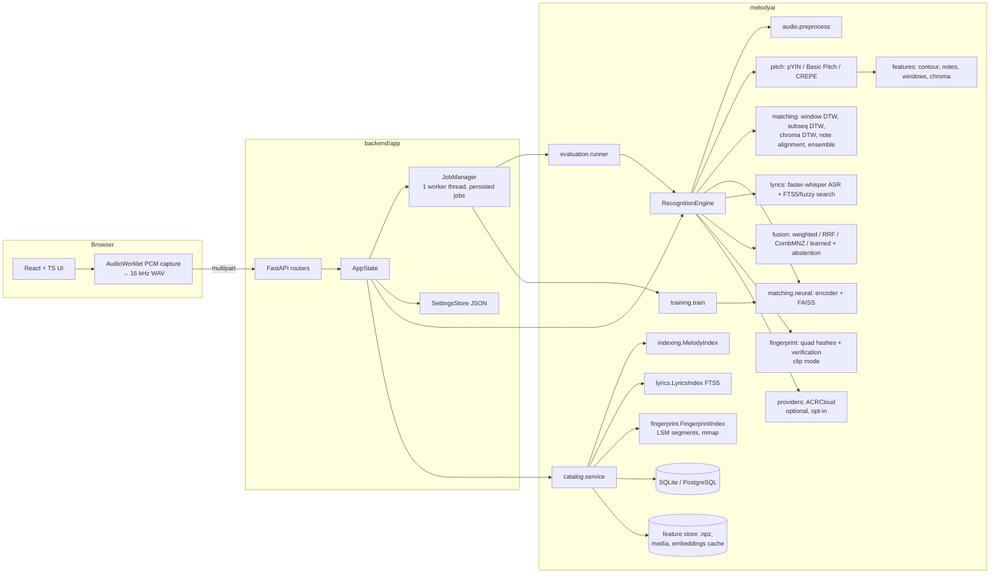
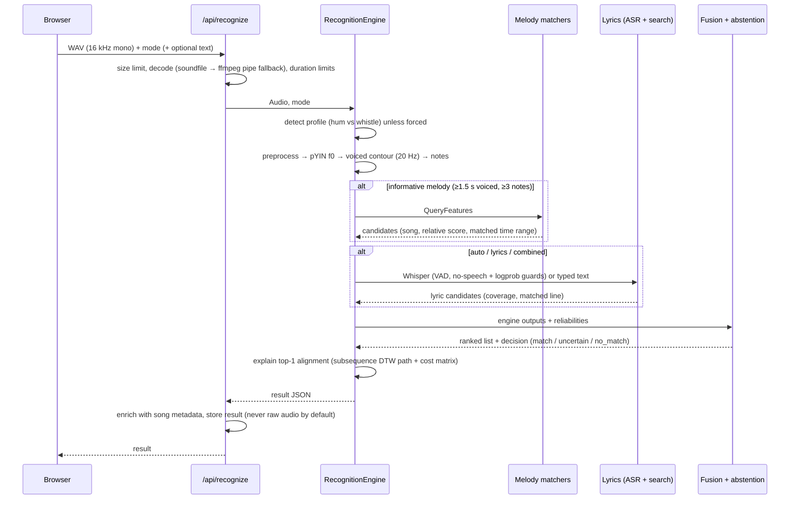

# Architecture

MelodyAI is three layers with strict dependencies in one direction:

```
frontend (React)  ──HTTP──▶  backend/app (FastAPI)  ──Python──▶  melodyai (science package)
```

`melodyai` never imports the server or the UI. Every algorithm runs from Python, the CLI,
the test suite and the benchmark harness without the web stack.

## Component map



## Recognition data flow



## Package layout

| Path | Responsibility |
|---|---|
| `melodyai/audio/io.py` | Decoding (soundfile; ffmpeg via stdin/stdout pipes as fallback), limits, WAV writing |
| `melodyai/audio/preprocess.py` | DC removal, 60 Hz high-pass, silence trimming, peak normalisation, quality indicators |
| `melodyai/audio/synth.py` | Additive synthesiser (piano, hum, voice, whistle, pad, bass), noise and reverb |
| `melodyai/pitch/` | `PitchTrack`, extractor registry (pYIN, Basic Pitch, torchcrepe), cleaning, note segmentation |
| `melodyai/features/melody.py` | `NoteSequence`, contour rendering, centring, octave folding, chroma helpers |
| `melodyai/features/windows.py` | Overlapping multi-length windows (6, 9, 13, 18, 25 notes), 96-point vectors |
| `melodyai/features/extract.py` | `QueryFeatures` / `ReferenceFeatures`, CQT chroma, audio → reference (mono / polyphonic) |
| `melodyai/matching/dtw.py` | numba DTW, subsequence DTW, banded batch DTW, Smith-Waterman |
| `melodyai/matching/algorithms.py` | Classical matchers behind a common `search()` interface |
| `melodyai/matching/ensemble.py` | Score-level ensemble of matchers |
| `melodyai/matching/neural.py` | Embedder, per-song embedding cache, FAISS index (flat / HNSW), neural + DTW re-ranking |
| `melodyai/matching/explain.py` | Alignment data for visualisation (computed, not decorative) |
| `melodyai/lyrics/` | Normalisation, FTS5 + fuzzy alignment search, faster-whisper wrapper |
| `melodyai/fusion/fusion.py` | Fusion strategies, abstention thresholds, Platt probability |
| `melodyai/indexing/melody_index.py` | Incremental in-memory window index |
| `melodyai/fingerprint/` | Log-frequency peaks, pitch-invariant quad hashes, segment index with verification (`clip` mode) |
| `melodyai/indexing/ivfpq.py`, `vector.py` | IVF-PQ (NumPy) and exact/IVF vector search; FAISS where usable |
| `melodyai/matching/scalable.py` | Two-stage melody search for large catalogs |
| `melodyai/providers/` | Licensed external catalogs (ACRCloud adapter) |
| `melodyai/evaluation/scale.py` | Scale benchmark (index size → accuracy/latency/memory) |
| `melodyai/catalog/` | SQLAlchemy models, importers (MIDI, audio, lyrics, CSV/JSON), catalog service |
| `melodyai/models/encoder.py` | PyTorch melody encoder |
| `melodyai/training/` | Data generation/augmentation, contrastive training loop |
| `melodyai/evaluation/` | Query sets, metrics, benchmark runner, report generator |
| `melodyai/demo/` | Original melody generator, original lyrics, query simulator, demo builder |
| `melodyai/engine.py` | Mode handling, engine orchestration, result shape |
| `backend/app/` | FastAPI app factory, routers, jobs, settings, analysis service |
| `frontend/src/` | Pages, recorder hook, canvas visualisations, API client |

## Storage

```
data/store/
  catalog.db                 songs, lyrics, recognitions (results only), jobs
  lyrics_fts.db              SQLite FTS5 (unicode61 + trigram tokenizers)
  features/mel-v1/<id>.npz   notes, contour, chroma of each reference
  media/<id>/reference.*     the imported file (+ preview.wav for MIDI)
  indexes/neural/<model-id>/<id>.npy   cached window embeddings per model
  recordings/<rec>.wav       ONLY when retention = keep_with_consent and the user ticked the box
  settings.json              user settings
```

* **Versioning.** `FEATURE_VERSION` (in `melodyai/config.py`) is stored with every song. At
  start-up, songs indexed with another version are flagged `stale`; `POST /api/catalog/index`
  (or `melodyai reindex`) recomputes only those. Neural embeddings are keyed by a hash of the
  checkpoint file.
* **Incrementality.** Adding a song computes features for that song only; the window matrix is
  a lazily rebuilt concatenation. `tests/integration/test_catalog_engine.py::test_H_*` checks
  that other feature files are untouched.
* **Database.** SQLite with WAL and foreign keys by default; `MELODYAI_DATABASE_URL` accepts
  any SQLAlchemy URL (PostgreSQL needs a driver such as `psycopg`; not exercised by the tests).

## Concurrency and jobs

* Recognition runs in FastAPI's thread pool, gated by an `asyncio.Semaphore`
  (`MELODYAI_MAX_CONCURRENT_RECOGNITIONS`, default 2) because pitch tracking is CPU-heavy.
* Long tasks (benchmarks, training, reindexing, demo import, model download) go through
  `JobManager`: one worker thread, state in the `jobs` table, progress throttled to ~2 writes/s,
  cooperative cancellation (`should_stop()` is checked between training steps / evaluation stages).
  Jobs still `running` when the server stops are marked `interrupted` on the next start.
* No message queue, no microservices: a single process is enough at this scale (rule 11).

## Security and privacy decisions

* Uploads are read in 1 MB chunks and rejected above the limit (413) before decoding.
* Decoding never touches client-provided paths; ffmpeg receives bytes on stdin.
* All IDs in paths are validated (`[A-Za-z0-9_.-]`, no `..`); experiment run IDs and figure
  names have their own strict patterns; neural checkpoints can only be chosen from a server-side list.
* No outbound network calls in the recognition path, except the optional licensed provider, which needs
  operator credentials *and* the user's opt-in, sends at most 12 s at 8 kHz, and validates the host name
  (`identify-*.acrcloud.(com|cn)`). Whisper models are downloaded only by an explicit command
  (`make asr-model`) or, if the server enables it, by a Settings action.
* Raw audio is never written to disk unless retention is `keep_with_consent` *and* the request sets
  `retain_audio`. The history stores results (including derived pitch data) and can be deleted.
* Logs do not contain audio or transcripts.

## Frontend

* React 18 + TypeScript + Vite + Tailwind. Components follow shadcn/ui conventions on top of
  Radix primitives (dialog, select, tabs, switch, slider, tooltip) for keyboard accessibility.
* `useRecorder` captures raw PCM through an AudioWorklet with echo cancellation / noise
  suppression / AGC disabled (they distort pitch), then resamples to 16 kHz and encodes WAV in
  the browser, so the server never needs browser-specific codecs for microphone input.
* Visualisations (`visualizations/canvas.tsx`) draw only arrays returned by the API.
* TanStack Query handles caching and job polling; Recharts draws metric charts.
