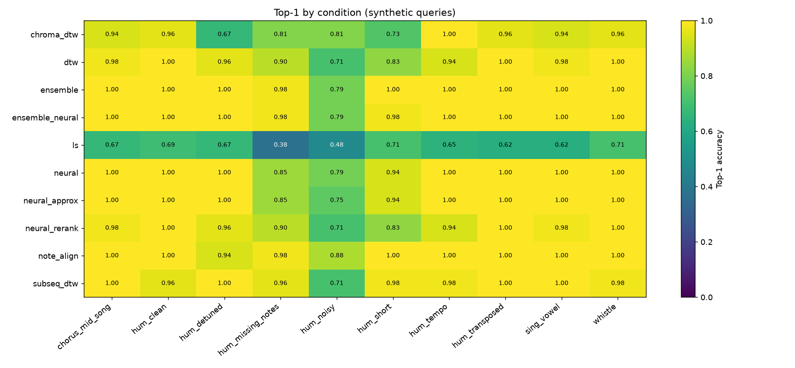
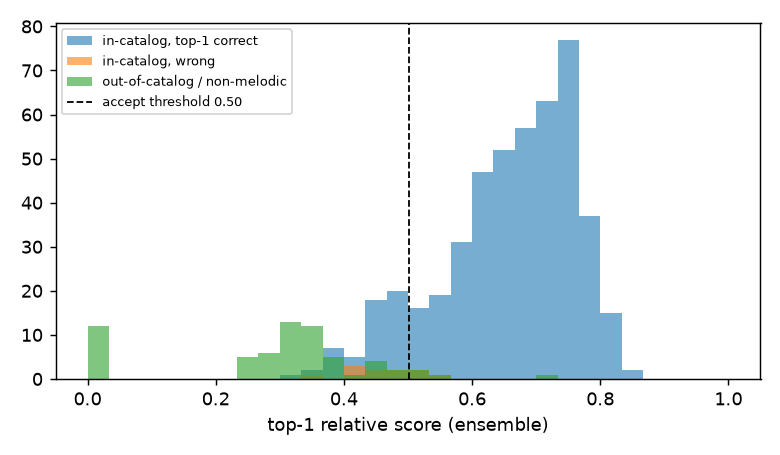
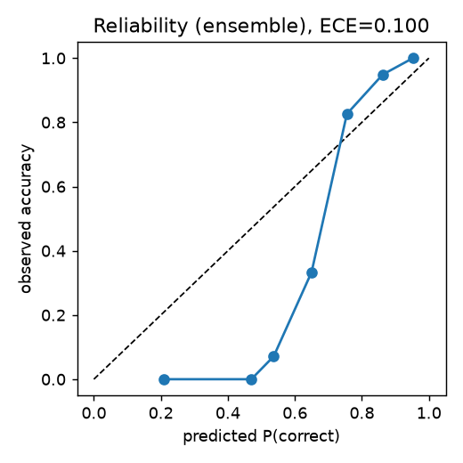
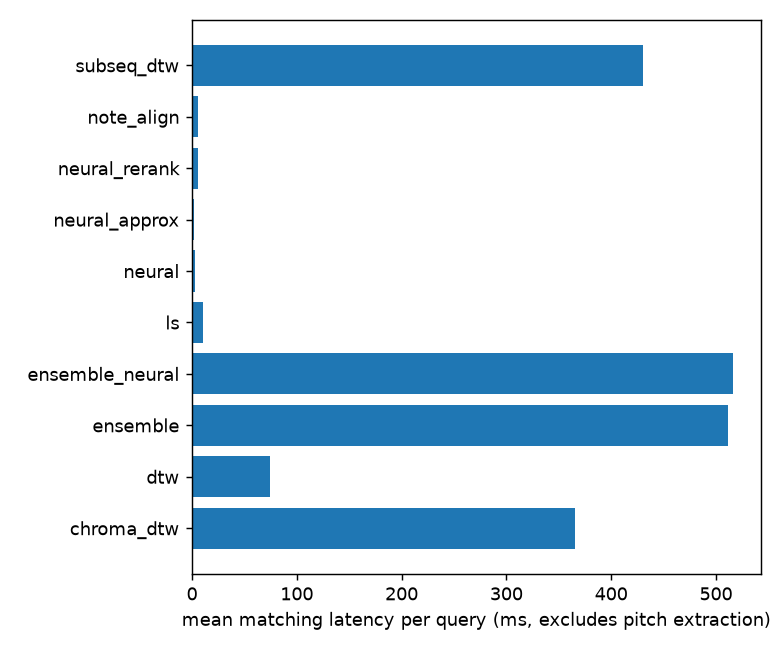

# Experimental results

> **Auto-generated** by `python -m melodyai.cli report` from `experiments/runs/20261107T113552Z-default/metrics.json`. Do not edit by hand; re-run `make evaluate` to refresh.

> **Scope.** Every query below is *synthetic*: original melodies from the procedural generator, rendered with simple hum/whistle/voice synthesisers and passed through the real pitch-tracking pipeline. The numbers measure robustness to controlled transformations on a small synthetic catalog. They are **not** an estimate of accuracy on real people's recordings or on large commercial catalogs (see `docs/LIMITATIONS.md`).

## Run

| Item | Value |
|---|---|
| Run id | `20261107T113552Z-default` |
| Date (UTC) | 2026-11-07T11:44:04.469235+00:00 |
| Seed | 2026 |
| Catalog | MelodyAI demo generator, 48 songs (seeds 1000+) |
| Queries | 544 (hash `36f223ef92`) |
| Out-of-catalog material | generator seeds 300000+ + non-melodic signals |
| Hardware | arm64 · 12 CPUs · 68.7 GB · macOS-27.0.1-arm64-arm-64bit |
| Software | Python 3.11.15, numpy 2.4.6, librosa 0.11.0, torch 2.15.0 (mps), faiss 1.15.1, faster-whisper 1.2.1 |
| Git commit | `c530d7b` |
| Wall time | 1266.1 s |

Neural model: `models/melody_encoder.pt` (id `melody_encoder-991ded010a`, epoch 30, device mps; validation on unseen compositions: top-1 88.3%, MRR 0.918).

## Melody recognition — algorithm comparison

In-catalog queries over all conditions. Latency = matching time per query on the machine above (pitch extraction excluded; it is reported separately below). Rejection columns: threshold fitted on the *dev* half of the songs to reach ≤5% false accepts on out-of-catalog/non-melodic dev queries, then measured on the *test* half.

The test half contains 32 out-of-catalog / non-melodic queries, so one false accept moves the false-accept rate by 3.1 points.

| Algorithm | Top-1 | Top-3 | Top-5 | MRR | Mean latency | AUC (correct vs OOC) | FAR@thr (test) | Accepted correct (test) | Dataset |
|---|---|---|---|---|---|---|---|---|---|
| `chroma_dtw` — CQT chroma + subsequence DTW | 87.7% | 93.1% | 94.4% | 0.907 | 366 ms | 0.861 | 0.0% | 54.0% | synthetic |
| `dtw` — Pitch contour + window DTW | 92.9% | 95.8% | 96.2% | 0.946 | 74 ms | 0.863 | 3.1% | 41.1% | synthetic |
| `ensemble` — Ensemble (dtw + note_align + subseq_dtw) | 97.7% | 97.9% | 98.1% | 0.979 | 511 ms | 0.960 | 6.2% | 88.9% | synthetic |
| `ensemble_neural` — Ensemble (dtw + note_align + subseq_dtw + neural_rerank) | 97.5% | 97.9% | 97.9% | 0.977 | 517 ms | 0.951 | 6.2% | 83.8% | synthetic |
| `ls` — Linear scaling (no DTW) | 61.9% | 71.0% | 76.5% | 0.680 | 11 ms | 0.774 | 9.4% | 46.9% | synthetic |
| `neural` — Neural embeddings (exact search, numpy) | 95.8% | 97.7% | 97.7% | 0.969 | 2 ms | 0.989 | 12.5% | 97.8% | synthetic |
| `neural_approx` — Neural embeddings (approx search, numpy) | 95.4% | 97.7% | 98.1% | 0.967 | 2 ms | 0.986 | 12.5% | 97.8% | synthetic |
| `neural_rerank` — Neural embeddings + DTW re-ranking | 92.9% | 95.8% | 96.2% | 0.946 | 5 ms | 0.864 | 3.1% | 41.1% | synthetic |
| `note_align` — Note intervals + Smith-Waterman | 97.9% | 99.2% | 99.4% | 0.985 | 6 ms | 0.980 | 6.2% | 91.6% | synthetic |
| `subseq_dtw` — Pitch contour + subsequence DTW (whole song) | 95.6% | 97.3% | 97.3% | 0.965 | 431 ms | 0.909 | 9.4% | 72.9% | synthetic |

### Top-1 accuracy by query condition

| Algorithm | chorus_mid_song | hum_clean | hum_detuned | hum_missing_notes | hum_noisy | hum_short | hum_tempo | hum_transposed | sing_vowel | whistle |
|---|---|---|---|---|---|---|---|---|---|---|
| `chroma_dtw` | 94% | 96% | 67% | 81% | 81% | 73% | 100% | 96% | 94% | 96% |
| `dtw` | 98% | 100% | 96% | 90% | 71% | 83% | 94% | 100% | 98% | 100% |
| `ensemble` | 100% | 100% | 100% | 98% | 79% | 100% | 100% | 100% | 100% | 100% |
| `ensemble_neural` | 100% | 100% | 100% | 98% | 79% | 98% | 100% | 100% | 100% | 100% |
| `ls` | 67% | 69% | 67% | 38% | 48% | 71% | 65% | 62% | 62% | 71% |
| `neural` | 100% | 100% | 100% | 85% | 79% | 94% | 100% | 100% | 100% | 100% |
| `neural_approx` | 100% | 100% | 100% | 85% | 75% | 94% | 100% | 100% | 100% | 100% |
| `neural_rerank` | 98% | 100% | 96% | 90% | 71% | 83% | 94% | 100% | 98% | 100% |
| `note_align` | 100% | 100% | 94% | 98% | 88% | 100% | 100% | 100% | 100% | 100% |
| `subseq_dtw` | 100% | 96% | 100% | 96% | 71% | 98% | 98% | 100% | 100% | 98% |

Conditions: see `melodyai/demo/queries.py` (`CONDITIONS`) and `docs/EVALUATION.md`.

### Calibration

Platt scaling (logistic regression on top score and margin) fitted on the dev half; ECE/Brier on the test half.

| Algorithm | ECE | Brier | n |
|---|---|---|---|
| `chroma_dtw` | 0.153 | 0.117 | 272 |
| `dtw` | 0.081 | 0.104 | 272 |
| `ensemble` | 0.100 | 0.057 | 272 |
| `ensemble_neural` | 0.098 | 0.063 | 272 |
| `ls` | 0.105 | 0.188 | 272 |
| `neural` | 0.116 | 0.054 | 272 |
| `neural_approx` | 0.115 | 0.055 | 272 |
| `neural_rerank` | 0.099 | 0.100 | 272 |
| `note_align` | 0.090 | 0.051 | 272 |
| `subseq_dtw` | 0.119 | 0.088 | 272 |

## Pitch extractors

Same synthetic queries analysed with each f0 extractor, matched with `ensemble`.

| Extractor | Top-1 | MRR | Mean pitch-extraction time per query | Top-1 hum_clean | Top-1 whistle | Top-1 hum_noisy |
|---|---|---|---|---|---|---|
| pyin | 93.1% | 0.938 | 3059 ms | 100% | 100% | 79% |
| crepe | 100.0% | 1.000 | 6707 ms | 100% | 100% | 100% |
| basic_pitch | 87.5% | 0.880 | 1277 ms | 100% | 75% | 88% |

Pitch-extraction times were measured while 8 query-synthesis worker processes ran in parallel, so they are inflated by CPU contention and only comparable with each other. The per-condition sample is 24 queries.

## Lyrics search (typed / transcribed text)

20 original lyric texts (12 English, 8 Spanish). Out-of-catalog = original distractor lines and random bags of catalog words (topic overlap without the actual text).

| Condition | Top-1 | MRR | n |
|---|---|---|---|
| asr_like_typos | 100.0% | 1.000 | 20 |
| exact_lines | 100.0% | 1.000 | 20 |
| misremembered | 100.0% | 1.000 | 20 |
| partial_4_words | 100.0% | 1.000 | 20 |

Rejection (test half): threshold 0.310, false accepts on distractors 0.0%, accepted correct 100.0%, AUC 1.000.

## Speech → lyrics (faster-whisper)

Spoken queries synthesised with **macOS say (synthetic speech)** (not human singing) and transcribed with Whisper `base` on CPU.

| Metric | Value |
|---|---|
| Song top-1 (language auto-detected) | 100.0% (n=20) |
| Song top-1 (language given) | 100.0% (n=20) |
| Language-ID accuracy (auto) | 100.0% |
| Mean word error rate | 0.04 |
| Real-time factor | 0.13 |
| Hummed/whistled queries producing words | 0.0% |

## Combined recognition (melody + words)

40 combined queries: a short (2.5–4 s) or noisy hum of a lyric song plus a few consecutive words from it with ~30% typo rate. With 4 words the text alone is usually enough; with 2 words it is ambiguous, which is where complementary melodic evidence can help. Melody matcher: `ensemble`.

| Strategy | Top-1 (4 words) | Top-1 (2 words) | MRR (4 words) | MRR (2 words) |
|---|---|---|---|---|
| melody_only | 95.0% | 95.0% | 0.955 | 0.955 |
| lyrics_only | 100.0% | 90.0% | 1.000 | 0.900 |
| weighted | 100.0% | 95.0% | 1.000 | 0.955 |
| rrf | 95.0% | 95.0% | 0.971 | 0.955 |
| combmnz | 97.5% | 95.0% | 0.983 | 0.955 |
| learned (dev→test, small sample) | 95.0% | 95.0% | 0.975 | 0.950 |

## Reference modality (MIDI vs audio vs polyphonic mixes)

The same 48 hummed/whistled queries for 16 songs, matched with `ensemble` against references derived in different ways. Polyphonic mixes = melody (piano) + pad chords + bass, synthesised. Note F1 compares the extracted reference melody with the true one (mir_eval).

| Reference built from | Top-1 | MRR | Note F1 |
|---|---|---|---|
| midi | 100.0% | 1.000 | 1.00 |
| monophonic_audio_pyin | 100.0% | 1.000 | 0.92 |
| polyphonic_basic_pitch_skyline | 66.7% | 0.763 | 0.74 |
| polyphonic_pyin_on_mix | 10.4% | 0.272 | 0.00 |

These mixes are far simpler than produced commercial recordings (no vocals, no drums, no effects); results on real polyphonic music are expected to be considerably worse and were not measured.

## Indexing cost

48 songs → 13926 melody windows; 146.94 ms per song (includes chroma of a synthesised rendering); window matrix 5.348 MB; process RSS delta 252.3 MB. Neural window embeddings for the whole catalog: 2.75 s.
