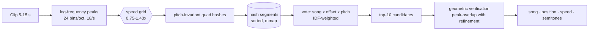
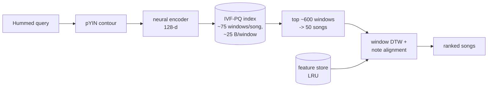

# Scaling MelodyAI: Spotify-size catalogs and TikTok clips

This document covers what it takes to recognise *commercial* songs (what people hear on Spotify,
TikTok, Reels, the radio) and what MelodyAI implements towards that goal. Measured numbers are in
[SCALE_RESULTS.md](SCALE_RESULTS.md) (auto-generated); this page explains the design and the limits.

## 1. Constraints that are not technical

| Question | Answer | Consequence |
|---|---|---|
| How big is the target? | Spotify reports roughly 250 million tracks (an executive's estimate, not an audited count, inflated by AI/spam uploads it keeps removing). "Billions of songs" does not exist. | Design for ~10^8 recordings. |
| Can we index Spotify's audio? | No. The Spotify Developer Policy forbids using Spotify content to train ML/AI models or ingest it into one, the API does not deliver full audio, and the User Guidelines forbid scraping. | Spotify is used only for *links* built from metadata. |
| Can we index TikTok's audio? | No: TikTok's terms forbid scraping. | A user may *submit* a clip they have; the catalog side must come from elsewhere. |
| Can anyone recognise commercial music then? | Companies that license catalogs from labels/distributors (ACRCloud, Shazam, Google…). ACRCloud advertises 150 M+ tracks for fingerprinting and a humming database of 1 M+ songs. | MelodyAI integrates such a provider as an *optional* engine (path A) and implements its own scalable engines for catalogs you have the right to use (path B). |

Even Google's Hum to Search launched with about half a million songs: humming search over the
*entire* commercial catalog is not something any public system claims.

## 2. Two different problems

| | Recording of the actual track (TikTok clip, song playing nearby) | Humming / whistling / singing |
|---|---|---|
| Technique | Audio fingerprinting (spectral-peak constellations) | Melody matching (pitch contour) |
| Engine in MelodyAI | `clip` mode (`melodyai/fingerprint`) | `hum`/`whistle` modes; `scalable` two-stage search for large catalogs |
| Reference needed | Any audio recording of the track | A melody: MIDI, isolated vocals, or a melody extracted from the mix (hard) |
| Scales to 10^8? | Yes (industrial practice); storage is linear in audio hours | Candidate generation scales; the bottleneck is obtaining good melody references from produced mixes |

## 3. Path A — licensed provider (ACRCloud)

1. Create an ACRCloud account and an *Audio & Video Recognition* project (enable humming / cover
   detection in the project if you want hums sent there as well).
2. Put the credentials in `.env` (never commit them):

   ```bash
   MELODYAI_ACRCLOUD_HOST=identify-eu-west-1.acrcloud.com
   MELODYAI_ACRCLOUD_ACCESS_KEY=...
   MELODYAI_ACRCLOUD_ACCESS_SECRET=...
   ```

   A separate humming project can be given with the `MELODYAI_ACRCLOUD_HUMMING_*` variables.
3. Restart the server. Settings → *Licensed catalog provider* shows "configured".
4. Each user opts in with *Send recordings to the provider*. Policy *Only if not found locally*
   (default) calls the provider only when the local catalog has no confident match.

What is sent: the loudest ≤ 12 s of the recording, as 8 kHz mono WAV, signed with HMAC-SHA1 per the
ACRCloud Identification API. The secret never leaves the server. Results (title, artist, album,
release date, ISRC, provider score, Spotify/YouTube/Deezer/MusicBrainz links) are shown in a separate
"Found in a licensed catalog" section and are **not** fused numerically with local scores (different
catalogs, different score scales). Costs, quotas and the provider's own data policy apply.

Verification status: request signing, payload, response parsing and error handling are tested against
the documented protocol with a mocked HTTP transport (`tests/unit/test_providers.py`). A live round trip
was **not** run (no credentials in the development environment); `test_live_acrcloud_roundtrip` runs
automatically when credentials are present.

## 4. Path B — MelodyAI's own engines at scale

### 4.1 Recordings and TikTok-style clips: fingerprinting



* **Pitch-invariant hashes.** Peaks are taken on a log-frequency axis, so a pitch shift is a
  translation; hashes contain only frequency *differences* (anchor + 3 targets, ~3.5·10^9 values in 32 bits).
* **Speed changes** (TikTok "sped up"/"slowed", which change tempo *and* pitch) are handled by rescaling
  query peak times over a 22-step grid; the pitch part is absorbed by the invariance.
* **Verification.** Hash votes produce candidates; the score is the fraction of query peaks that land
  on reference peaks after the best alignment (speed refined ±3%, offset, transposition). This rejects
  songs that merely share generic chord shapes.
* **Storage.** Log-structured segments (`.npy`, memory-mapped): 16 B per hash posting + 10 B per peak.
  New songs go to a delta flushed as small segments; tiered merging keeps work proportional to new data;
  deletions are tombstones dropped on compaction. Measured cost per audio hour: see SCALE_RESULTS.md.
* **Sharding to 10^8 tracks.** Segments are independent; partition songs by `hash(song_id) mod S` into S
  shard directories, query all shards in parallel and merge the top candidates before verification.
  Not implemented as a service (single process today); the storage format was chosen so it is a
  deployment step, not a redesign.

### 4.2 Humming at scale: two-stage melody search



* **Stage 1** is sub-linear: an IVF-PQ index (`melodyai/indexing/ivfpq.py`, NumPy; FAISS `IndexIVFPQ`
  where FAISS can be used) over neural embeddings of mid-length reference windows.
* **Stage 2** runs the best classical matchers only on the ~50 candidate songs, loading their features
  on demand (LRU), so the catalog does not need to fit in RAM.
* The exhaustive matchers in the app (`dtw`, `note_align`, `ensemble`…) keep every window in memory and
  scan them all: fine up to ~10^4 songs, not beyond (see the exhaustive-latency column in
  SCALE_RESULTS.md).

### 4.3 Ingesting large licensed collections

```bash
make ingest DIR=/path/to/licensed/music        # or: melodyai ingest DIR --workers 8 --license "..."
```

Worker processes decode, extract the melody (Basic Pitch + skyline for polyphonic audio) and fingerprint
each file; the main process stores the results. Files already present (same SHA-256) are skipped, so an
interrupted ingestion can be restarted. A `metadata.csv/json` manifest (same format as `import-dir`)
provides titles, artists, licences and lyrics.

Legally usable sources include your own recordings, music licensed from rights holders/distributors, and
Creative-Commons collections such as the Free Music Archive (FMA) or MTG-Jamendo — check each track's
licence before use.

## 5. What remains hard (and is not solved here)

* **Melody references from produced commercial mixes.** On simple synthetic mixes the Basic Pitch
  skyline reached 66.7% top-1 (docs/RESULTS.md); real productions with vocals, drums and dense
  arrangements need source separation (e.g. Demucs) + vocal f0 tracking, or an end-to-end
  spectrogram encoder trained on large paired data (Google's approach). Neither is implemented.
* **Voice-over and heavy edits.** A voice as loud as the music defeats fingerprinting in our benchmark;
  separation or learned audio embeddings would be needed.
* **Real data.** Every number in SCALE_RESULTS.md is synthetic. Real catalogs contain covers, remixes and
  near-duplicates that make abstention thresholds and accuracy different; recalibrate on real labelled
  queries before relying on them.
* **Distributed serving.** Sharding, replication and an ingestion queue are deployment work that only
  makes sense with a licensed catalog in hand.

## Sources

* Spotify developer policy on ML/AI use (secondary reporting and Spotify community answers):
  [Hypebot (2025)](https://www.hypebot.com/updated-spotify-terms-mean-you-cant-use-their-data-but-they-can-use-yours/),
  [Spotify Community](https://community.spotify.com/t5/Spotify-for-Developers/Looking-for-clarity-on-the-no-ML-AI-developer-policy-for-a/m-p/5611910/highlight/true)
* Spotify catalog size: [Music in Africa](https://www.musicinafrica.net/node/389775)
* ACRCloud: [Humming recognition](https://acrcloud.com/humming-recognition/),
  [Identification API](https://docs.acrcloud.com/reference/identification-api),
  [music metadata](https://docs.acrcloud.com/reference/identification-api/metadata/music)
* Product quantization: Jégou, Douze & Schmid (2011), *Product quantization for nearest neighbor search*, IEEE TPAMI 33(1).
* Landmark fingerprinting: Wang (2003), *An industrial-strength audio search algorithm*, ISMIR.
* Tempo/pitch-robust fingerprinting with quads: Sonnleitner & Widmer (2016), *Robust quad-based audio fingerprinting*, IEEE/ACM TASLP 24(3).
